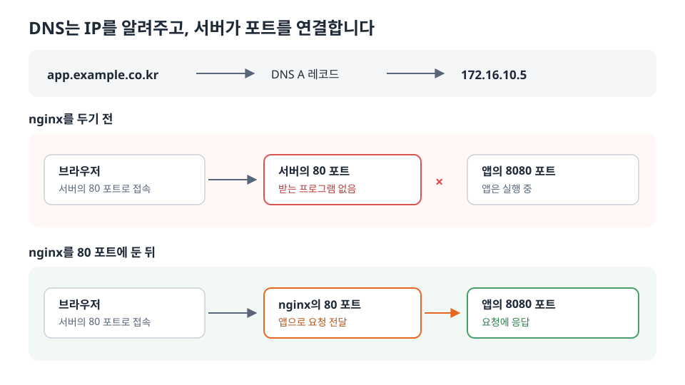
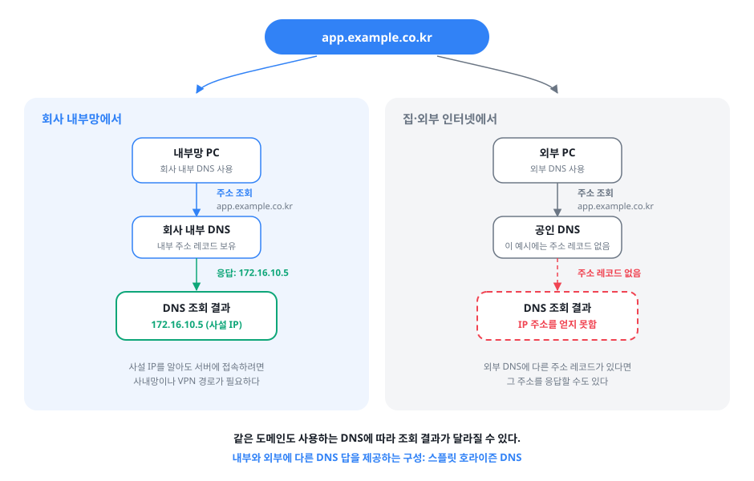

> 도메인을 서버 IP에 연결했는데도 접속되지 않았습니다. DNS가 알려주는 주소와 브라우저가 접속하는 포트가 다르다는 걸 확인하고, nginx로 두 구간을 연결한 기록입니다.

<!--more-->

운영 중인 사내 웹 서비스에 도메인을 붙이면서 전산 담당자분께 `app.example.co.kr`을 `172.16.10.5:8080`으로 세팅했다는 말을 들었습니다. 그런데 브라우저에서 도메인으로 접속하면 열리지 않았습니다. 설정은 끝났다는데 어디서 막혔는지 감이 오지 않았습니다.

확인해 보니 DNS가 할 수 있는 일과 서버에서 해야 하는 일을 제가 한데 묶어 생각하고 있었습니다.

## DNS는 포트를 모른다

이 사례에서 `app.example.co.kr`의 DNS 조회 결과는 IP 주소 `172.16.10.5`였습니다. 앱이 사용하는 8080 포트는 이 응답에 포함되지 않습니다.

담당자분이 설정한 A 레코드에는 IP 주소만 들어갑니다. AAAA 레코드는 IPv6 주소를, CNAME은 다른 도메인 이름을 가리킵니다. 포트를 담는 SRV 레코드도 있지만, 브라우저는 일반적인 주소창 접속에 SRV를 사용하지 않습니다. 따라서 DNS에 `172.16.10.5:8080`을 등록해 브라우저를 8080 포트로 보낼 수는 없습니다.

주소창에 포트를 적지 않으면 브라우저는 `http`에 80, `https`에 443을 사용합니다. 이때 앱은 8080 포트에서만 요청을 받고 있었습니다.

실제로 `http://app.example.co.kr:8080`으로는 접속됐습니다. 도메인이 IP를 찾고 8080 포트의 앱까지 도달한다는 걸 확인한 뒤, 80 포트에서 요청을 받는 쪽을 살펴봤습니다. 거기에는 아직 아무 프로그램도 없었습니다.

DNS 조회 자체가 의심될 때는 PC의 `hosts` 파일과 DNS 캐시도 확인해야 합니다. `hosts`에 주소가 지정돼 있거나 이전 DNS 응답이 TTL 동안 캐시돼 있으면, 레코드를 바꾼 뒤에도 예상과 다른 IP로 접속할 수 있습니다.

## 그래서 리버스 프록시가 필요했습니다

사용자에게 매번 `:8080`을 붙여 접속하라고 할 수는 없었습니다. 저는 80 포트로 들어온 요청을 앱의 8080 포트로 전달하도록 nginx를 설정했습니다.



```nginx
server {
    listen 80;
    server_name app.example.co.kr;

    location / {
        proxy_pass http://127.0.0.1:8080;
        proxy_set_header Host              $host;
        proxy_set_header X-Real-IP         $remote_addr;
        proxy_set_header X-Forwarded-For   $proxy_add_x_forwarded_for;
        proxy_set_header X-Forwarded-Proto $scheme;
    }
}
```

리버스 프록시는 사용자의 연결을 받아 앱에 새 연결을 맺습니다. 그래서 앱이 직접 보는 접속자는 nginx입니다. `proxy_set_header`는 원래 요청의 호스트, 클라이언트 IP, 스킴 정보를 앱에 전달하기 위해 넣었습니다.

이때 `server_name`은 도메인을 등록하는 설정이 아닙니다. DNS는 도메인에 대응하는 IP를 알려주고, nginx는 도착한 요청의 호스트 이름을 보고 처리할 서버 블록을 고릅니다. 포워드 프록시가 클라이언트 쪽의 대리인이라면, 여기서 쓴 리버스 프록시는 서버 앞에서 요청을 받는 쪽입니다.

### SSE 경로는 별도로 설정했습니다

서비스에는 SSE(Server-Sent Events)로 작업 진행 상태를 보내는 기능도 있었습니다. nginx의 응답 버퍼링과 읽기 타임아웃 때문에 알림이 늦게 도착하거나 연결이 끊길 수 있어, SSE 경로에는 예외 설정을 뒀습니다.

```nginx
    location /sse {
        proxy_pass http://127.0.0.1:8080;
        proxy_set_header Connection '';
        proxy_http_version 1.1;
        proxy_buffering off;
        proxy_cache off;
        proxy_read_timeout 24h;
    }
```

버퍼링을 끄고 읽기 타임아웃을 길게 잡아, 앱이 보낸 알림을 nginx가 모아 두지 않고 전달하도록 했습니다.

## 사설 IP라서 생기는 일

서버 주소 `172.16.10.5`는 사설 IP입니다. 이 주소로 접속하려면 사용자 PC에서 사내망이나 VPN을 통해 서버까지 갈 수 있어야 합니다. 제가 다룬 서비스도 내부망에서 사용했습니다.

같은 도메인이라도 어느 DNS 서버에 물었는지에 따라 다른 답을 받을 수 있습니다. 예를 들어 내부 DNS는 사설 IP를 알려주고 외부 DNS는 다른 주소를 알려주거나 해당 주소 레코드가 없을 수 있습니다. 이를 스플릿 호라이즌(split-horizon) DNS라고 부릅니다.

아래 그림은 외부 DNS에 해당 주소 레코드가 없는 경우를 예로 들었습니다.



이 때문에 도메인 문제를 확인할 때는 접속을 시도한 PC가 어느 네트워크에 있고, 어떤 DNS 응답을 받았는지도 함께 봐야 합니다.

## 어디서부터 다른 영역인가 - 인프라와 애플리케이션의 경계

처음에는 도메인을 설정했다는데 왜 접속이 안 되는지 막막했습니다. 요청이 앱에 닿기까지의 구간을 나눠 보니 어디가 비었는지 보였습니다.

| 구간 | 하는 일 | 주로 확인할 영역 |
|---|---|---|
| DNS | `app.example.co.kr`이 가리키는 IP 확인 | 인프라 |
| 네트워크 | 사용자 PC에서 서버 포트까지 도달하는지 확인 | 인프라 |
| 리버스 프록시 | 서버에 도착한 요청을 앱으로 전달 | 서버 설정 |
| 앱 | 8080 포트에서 요청에 응답 | 애플리케이션 |

제 경우 DNS와 8080 포트 접속은 확인됐고, 서버의 80 포트에서 요청을 받을 프로그램이 없었습니다. 전산 담당자분이 알려주신 DNS 설정과 nginx 설정은 서로 다른 작업이었습니다. 누구의 잘못인지 따지기보다, 요청이 어디에서 끊기는지 확인하는 게 먼저였습니다.

서버 바깥의 경로와 서버 안에서 돌아가는 프로그램은 보통 담당 영역이 다릅니다. 다만 OSI 계층 번호만으로 그 경계를 자를 수는 없습니다. DNS는 응용 계층이지만 인프라에서 관리할 수 있고, 같은 80 포트라도 방화벽에서 허용하는 일과 서버에서 요청을 받는 일은 다릅니다.

이후에는 "접속이 안 됩니다" 대신 확인한 구간을 전했습니다. 이번에는 "도메인으로 IP를 찾고 8080 포트의 앱에는 접속됩니다. 서버의 80 포트에서 요청을 받을 nginx 설정을 추가하겠습니다"라고 말할 수 있었습니다. 사용자 PC에서 서버까지 닿지 않는다면, 그때는 네트워크 구간의 확인을 부탁하면 됩니다.

## 접속이 안 될 때의 진단 순서

다음에는 접속을 시도하는 PC와 서버에서 차례로 확인하려고 명령을 적어 뒀습니다.

```bash
cat /etc/hosts                 # 접속을 시도하는 PC에서 이름의 별도 지정 여부 확인
nslookup 도메인                 # 해당 PC가 받는 DNS 응답 확인
telnet 서버IP 80               # 해당 PC에서 서버 80 포트 연결 여부 확인
curl -I http://127.0.0.1/      # 서버에서 nginx 응답 확인
curl -I http://127.0.0.1:8080/ # 서버에서 앱 응답 확인
```

한 명령의 실패만으로 원인을 확정할 수는 없습니다. 예를 들어 80 포트 연결 실패에는 방화벽 문제와 리스너 부재가 모두 포함될 수 있습니다. `도메인:8080`으로는 접속되고 포트 없이 접속되지 않는다면 DNS를 다시 설정하기보다 80 포트의 연결 상태부터 확인하는 편이 빨랐습니다.

## 마치며

"도메인을 IP:포트로 세팅했다"는 말을 듣고 DNS가 포트까지 연결해 줄 거라고 생각했습니다. 직접 확인해 보니 DNS는 IP를 알려줬고, 서버의 80 포트에서 앱으로 이어 주는 설정이 빠져 있었습니다.

프론트 개발자가 왜 이런 것까지 알아야 하나 싶었지만, 어느 구간에서 끊기는지 알면 제가 고칠 설정인지 다른 담당자에게 확인을 부탁할 일인지 말할 수 있습니다. 이제는 도메인 접속이 안 되면 이름, 주소, 포트 중 어디까지 확인됐는지부터 봅니다.
