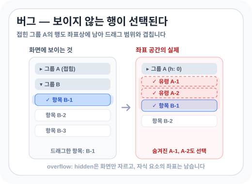
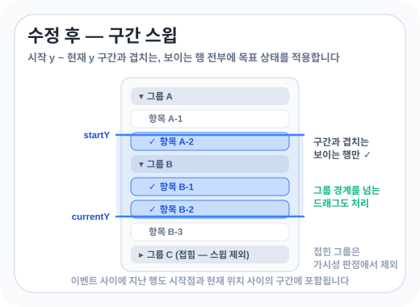

> 체크리스트에 Shift 드래그 다중 선택을 넣었습니다. 브라우저 이벤트를 처리하고 마우스 이동 중의 작업을 줄인 뒤, 스테이징에서 접힌 그룹의 항목까지 선택되는 버그를 발견했습니다.

<!--more-->

React 체크박스 리스트에서 Shift 드래그로 연속된 항목을 선택하도록 만들었습니다. 처음에는 지나는 행마다 체크 상태를 토글했는데, 이미 체크된 행은 풀려서 결과가 일정하지 않았습니다. 드래그 시작 시 선택할지 해제할지를 정하고 모든 행에 같은 값을 적용했습니다. Shift만 누르면 선택하고 Ctrl 또는 Cmd를 함께 누르면 해제했습니다.

공유 스크롤 컨테이너의 `mousedown`에서 드래그를 시작했습니다. 이동과 종료를 감지하는 리스너는 마우스가 목록 밖으로 나가도 동작하도록 `window`에 등록했습니다. `mousemove`에서 범위를 갱신하고 `mouseup`이나 Shift 키를 뗄 때 끝냈습니다. 체크 상태만 React state에 두고, 드래그 목표값과 클릭 억제 플래그는 ref에 뒀습니다. 컴포넌트가 사라질 때는 리스너와 예약된 rAF를 정리했습니다.

브라우저 이벤트에서도 몇 가지를 놓쳤습니다. 체크박스의 label 클릭이 드래그 직후 다시 발생해 시작 행이 두 번 토글돼 `onClickCapture`에서 해당 클릭을 막았습니다. macOS는 Ctrl+클릭을 우클릭으로 바꾸므로 그 조합과 Cmd 키를 별도로 처리했습니다. 창의 포커스를 잃어 Shift `keyup`을 놓칠 수 있어, 마우스가 움직일 때마다 `shiftKey`도 확인했습니다.

## 마우스 이동 중의 작업 줄이기

처음에는 행의 `mouseenter`를 보고 선택했지만 빠르게 끌면 중간 행이 빠졌습니다. 마우스 좌표로 행을 찾으려면 행 위치가 필요했습니다. 이동할 때마다 모든 행을 재측정하면 비용이 커집니다.

드래그를 시작할 때 `getBoundingClientRect()`로 행 좌표를 측정해 캐시했습니다. 스크롤하면 좌표가 달라지므로 캐시만 비우고 다음 마우스 이동에서 다시 측정했습니다. 목록 컨테이너의 `scroll`은 버블링하지 않아 `window`에 캡처 리스너를 등록했습니다. 자세한 내용은 [scroll 이벤트는 왜 window에서 잡히지 않을까](/study/event-propagation-capture-bubble)에 적었습니다.

마우스 이동은 rAF로 프레임당 한 번만 처리하고, 그사이 들어온 좌표 중 마지막 값을 사용했습니다. 자세한 내용은 [고빈도 이벤트에 requestAnimationFrame 스로틀을 쓰는 이유](/study/raf-throttle-high-frequency-events)에 적었습니다. 좌표가 위에서 아래로 정렬돼 있어 행을 찾을 때는 이진 탐색을 썼습니다. 다만 이 사례에서는 탐색보다 레이아웃 측정을 줄이는 일이 더 직접적이었습니다.

자동 테스트를 통과한 뒤 스테이징에 배포했습니다. 그런데 그룹 리스트에서 문제가 드러났습니다.

## 접힌 그룹의 항목까지 선택됐습니다

스테이징에서 이런 제보를 받았습니다.

> "한 그룹에서 항목 하나만 드래그했는데, **접혀 있는 다른 그룹들의 항목이 2개씩 같이 선택돼요.** 클릭은 멀쩡한데 드래그만 그래요."

단일 리스트에서는 재현되지 않았고, 그룹을 접고 펼치는 리스트에서만 나타났습니다.



접힌 그룹의 리스트는 언마운트되지 않고 `height: 0; overflow: hidden`으로 가려져 있었습니다. 각 리스트 인스턴스가 같은 스크롤 컨테이너에 `mousedown` 리스너를 등록했기 때문에, 접힌 그룹도 드래그 시작 이벤트를 받았습니다.

처음에는 `getBoundingClientRect().height`로 숨겨진 행을 걸러내려 했지만 실패했습니다. 잘린 자식 요소의 크기와 좌표는 남아 있었고, 그 좌표가 보이는 행의 드래그 범위와 겹쳤습니다. 그래서 클릭은 보이는 행에만 적용됐지만, 좌표로 계산하는 드래그는 접힌 그룹의 항목도 선택했습니다.

## 가시성을 확인하고 드래그 구간을 계산했습니다

접힌 그룹을 제외하기 위해 조상 중 `offsetHeight`가 0인 요소가 있는지 확인했습니다.

```tsx
const isEffectivelyVisible = (el: Element, boundary: Element): boolean => {
  let cur: Element | null = el;
  while (cur && cur !== boundary) {
    if (cur instanceof HTMLElement && cur.offsetHeight === 0) return false;
    cur = cur.parentElement;
  }
  return true;
};
```

`height: 0`인 조상의 `offsetHeight`는 0이어서, 이 판정을 드래그 시작 조건에 넣었습니다. 빠른 이동에서 빠지는 행을 메우던 보정도 바꿨습니다. 이제 시작점과 현재 위치 사이의 세로 구간에 겹치는 보이는 행을 모두 찾습니다.

```tsx
const range = findIntersectingRange(   // 정렬된 행 좌표에서 이진 탐색 2회 (구간 양 끝)
  Math.min(startY, currentY),
  Math.max(startY, currentY),
);
for (let i = range[0]; i <= range[1]; i++) {
  if (isChecked(rows[i]) !== target) applyCheck(target, rows[i]);
}
```

구간의 양 끝을 이진 탐색으로 찾아 범위를 구했습니다. 마우스 이동 이벤트 사이에 지나친 행도 포함되고, 펼친 그룹의 인스턴스는 자기 행 중 구간에 걸친 항목에만 목표 상태를 적용했습니다.

버그를 고치면서 코드도 50줄 줄었습니다.



## 마치며

처음에는 리스트가 하나이고 화면에 보이는 행만 좌표 계산에 들어온다고 생각했습니다. 스테이징의 그룹 리스트에서는 접힌 인스턴스도 살아 있었고, 잘린 자식의 좌표도 남아 있었습니다. 이번에는 드래그를 시작할 수 있는 인스턴스를 먼저 제한하고, 보이는 행 중 드래그 구간과 겹치는 항목에만 목표 상태를 적용했습니다.
